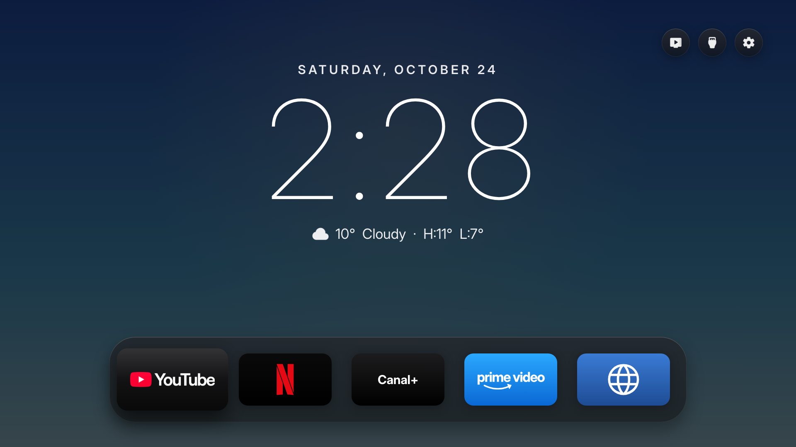

# Free My TV (personal fork)

This repository is a clone of [simbasjungles/free-my-tv](https://github.com/simbasjungles/free-my-tv), with my changes
for my Sharp Google TV. The original project's full history is kept; the original repository is the `upstream`
remote.



*The home screen in dark theme: date, time and weather centred over a sky that follows the hour, and the app shelf at
the bottom (screenshot taken locally from the LG/Samsung preview).*

## What changes from the original project

- **Home without picks**: the date, a large Inter Thin clock and the weather, centred over a sky whose colour follows
  the hour. In dark theme, the same sky, much deeper.
- **App shelf**: YouTube, Netflix, Canal+, Prime Video and a web browser.
- **Sharp TV**: its system pieces are protected (never turned off).
- **Preview**: logos for the sample apps, and the preview is served over HTTP.

Details, commands and pitfalls are in [NOTES.md](NOTES.md). The original project's documentation is in
[README.upstream.md](README.upstream.md), and the instructions for Claude Code in [CLAUDE.md](CLAUDE.md).

## Build and install

```bash
# Android app (Java 17: with Java 27, d8 crashes)
JAVA_HOME=/opt/homebrew/opt/openjdk@17/libexec/openjdk.jdk/Contents/Home ./build.sh
adb connect <TV IP>:5555
adb install -r FreeMyTV.apk

# LG/Samsung preview, then http://localhost:8000
python3 webos/build.py --preview
python3 -m http.server -d out/webos
```

`config.properties` (city, settings) and `freemytv.keystore` (the key that signs the app) stay on the computer and are
never committed. Without the same key, the TV refuses updates: back it up somewhere safe.

## Pull in the original project's updates

```bash
git fetch upstream
git merge upstream/main
```
